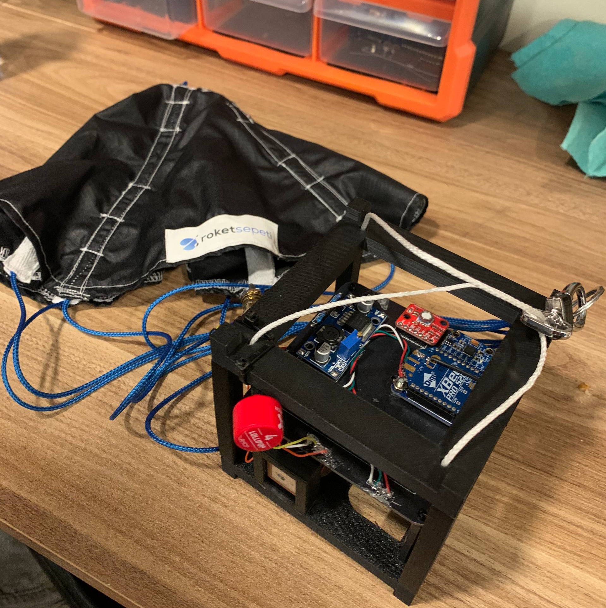
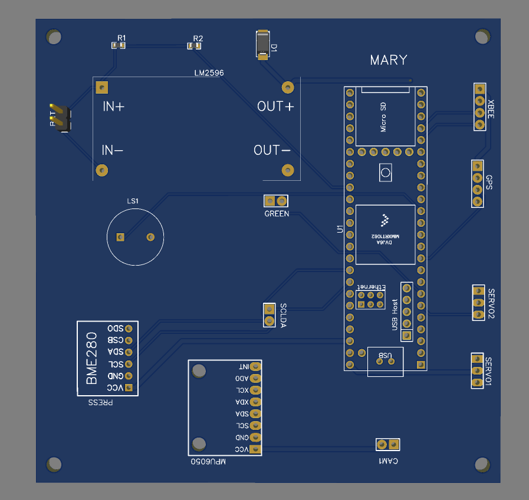

#  CubeSat Avionics & Ground Station Architecture

An end-to-end aerospace telemetry, communication, and ground control system designed for a CubeSat prototype. The project bridges low-level embedded firmware, wireless RF transmission, a Python multi-threaded backend, and a real-time web dashboard.

---

##  Hardware & 3D PCB Preview

| System Assembly (CubeSat) | EasyEDA 3D PCB Layout |
| :---: | :---: |
|  |  |

---

##  System Architecture Overview

The system is divided into three core layers:

```text
+---------------------------------------------------------------+
|                    Browser (Frontend)                         |
| index.html + style.css + app.js                               |
|  - Dashboard UI & Live Alarms                                 |
|  - Charts (Chart.js) & Map (Leaflet)                          |
|  - 3D CubeSat Visualization (Three.js)                        |
+-------------------------- HTTP -------------------------------+
                          Flask API
+---------------------------------------------------------------+
|              Python Ground Station (app.py)                   |
|  - Thread #1 : XBee Serial Reader (COM Port telemetry)        |
|  - Thread #2 : Video Capture & MJPEG Stream                   |
|  - Main Thread : Flask Web Server & REST API                  |
+-------------------------- UART -------------------------------+
                         XBee Radio
+---------------------------------------------------------------+
|                     CubeSat / Teensy                          |
|                     all_sensors.ino                           |
|  Sensors -> JSON -> XBee -> Ground Station -> Commands Back   |
+---------------------------------------------------------------+
```
---

##  Core Components

### 1. Flight Computer Firmware (`all_sensors.ino`)
- **Hardware:** Teensy 4.1 microcontroller (ARM Cortex-M7).
- **Sensors Integrated:** BME280 (Pressure/Temp), MPU6050 (6-axis IMU), GPS module, cameras, and servos.
- **Responsibilities:** Polls onboard sensors, calculates derived telemetry, packages data into JSON strings, transmits via XBee, and handles incoming operator commands (`CMD:MSG:`).

### 2. Python Ground Station Backend (`app.py`)
Built with Flask and multi-threading for robust real-time operations:
- **Telemetry Thread:** Reads serial data streams from the XBee radio, parses incoming JSON packets, updates shared thread-safe structures, and runs mission error-checking logic (ISS error flags).
- **Video Thread:** Captures live USB camera feeds via OpenCV and encodes MJPEG streams.
- **REST API Endpoints:**
  - `GET /api/data` — Live telemetry polling.
  - `GET /video_feed` — Real-time camera streaming.
  - `POST /api/select_camera` — Dynamic camera switching.
  - `POST /api/send_message` — Uplink command transmission to the satellite.

### 3. Web Dashboard Frontend
- **UI/UX:** Responsive dark theme built with CSS Grid.
- **Features:** Live data polling every second, telemetry charts, interactive Leaflet maps, 3D CubeSat rotation orientation, and system alarm monitors.

### 4. Telemetry Cryptography & Decoding (`decrypt.py`)
Includes a data processing pipeline to securely handle and decrypt mission flight logs (`ASTRA.sec`):

`[ASTRA.sec] ──> Base64 Decoding ──> XOR Decryption (Key: ASTRA_2026_KEY) ──> UTF-8 ──> [ASTRA.csv]`

---

##  Mission Error Logic (ISS Validation)
The system tracks critical flight parameters through automated validation routines:
- **ERR_01:** Descent rate validation.
- **ERR_02:** GPS coordinate validity check.
- **ERR_03:** Mission altitude & IoT status verification.
- **ERR_04:** RF radio link connection stability.
